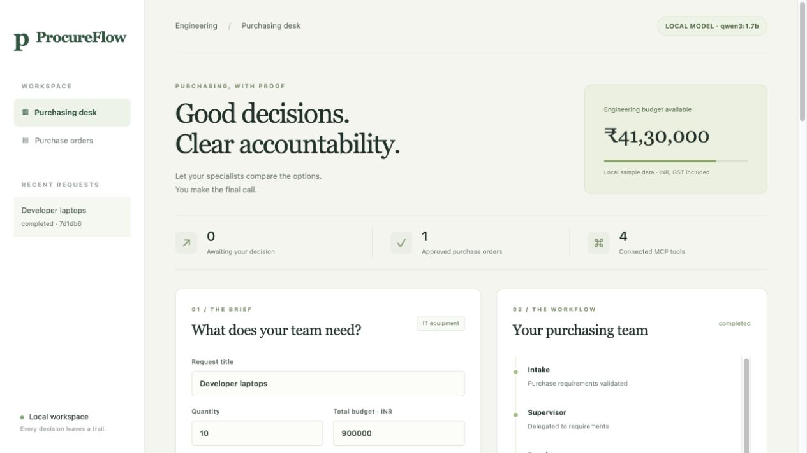

# ProcureFlow

**Purchasing, with proof.** A local purchasing assistant that compares fictional supplier quotes, explains policy outcomes, and waits for human approval before creating a simulated purchase order.

Built for Week 4 of the AI Bootcamp: LangGraph state machines, specialist delegation, MCP tools, SQLite memory, context management, retries, human interrupts and checkpoint branches.



## Verified on this Mac

- 15 integration tests passed; 8/8 deterministic purchasing scenarios passed.
- Actual Qwen3 1.7B inference reached the human approval gate in 6.98 seconds in the final smoke test. This is one measured warm run, not a latency guarantee or accuracy benchmark.
- The browser completed a model-assisted purchase only after explicit approval, then restored the same order after an application restart.
- Ruff checks and formatting, JavaScript syntax checks, and the read-only raw SDK example passed.

## What makes the workflow useful

A cheap quote can be the wrong purchase. ProcureFlow explains why a supplier fails the actual constraints, compares eligible alternatives, and shows the exact order before approval. A reviewer can revise or reject. Progress survives a process restart. Repeated execution cannot create duplicate orders for the same request.

The sample brief is ten developer laptops, at least 32 GB RAM, INR 900000, delivered in 14 days. Best value selects Orbit for INR 810000 in deterministic demo mode; Performance & warranty selects Cedar for INR 870000. The cheaper unapproved supplier is excluded by code, not by trusting a prompt.

## Start here

Python 3.11+ is required. From this directory:

```sh
./scripts/setup.sh
./scripts/run.sh
```

Open **http://127.0.0.1:8040**. The default is clearly labeled **DEMO MODE - NO LLM**. This mode runs the real LangGraph, MCP subprocess and durable checkpoint workflow, with deterministic specialist responses. It requires no model, paid API, or cloud account.

For the exact versions tested on this Mac (Python 3.12, macOS arm64), use:

```sh
./scripts/python.sh -m pip install -r requirements.lock
```

The lock includes the editable project reference `-e .`; run it from this directory. On macOS, setup stores packages in `~/Library/Caches/ProcureFlow/venv`. This avoids dependency eviction under synced Documents. Linux uses `.venv` directly. Override with `PROCUREFLOW_VENV` if needed. Source data is packaged at `procureflow/data/catalog.json` and is copied into a new business database on first start. Editing the seed file does not rewrite an existing workspace.

## Real local open model

Install [Ollama](https://ollama.com/download), run its local server, and pull a model:

```sh
ollama pull qwen3:1.7b
PROCUREFLOW_MODE=ollama PROCUREFLOW_MODEL=qwen3:1.7b ./scripts/run.sh
```

The compact 1.7B model is a practical starting point for this 8 GB Mac; output quality and latency vary. A larger model can be configured on suitable hardware. No cloud model is required. Model selection uses structured reason codes whose claims are checked against the catalog; displayed numerical facts and tradeoffs are rendered from trusted data. Model failure is reported and leaves a resumable checkpoint; it never silently changes to demo mode.

A project-local Ollama runtime/model was also prepared on this development machine. To use that copy:

```sh
# Terminal 1: local model server, cloud features disabled
./scripts/serve_local_model.sh

# Terminal 2: application
./scripts/run_local.sh
```

`run_local.sh` uses `.runtime/local-model-demo`, matching the verified local-model preview. Restart it with the same command to retain its requests and approvals.

That runtime and the model are ignored and are not included in source control. Ollama may maintain its normal identity/configuration in `~/.ollama`; project model weights are in `.runtime/models`. Do not delete `.runtime` to reset business data, since it can also contain model weights. Use a fresh `PROCUREFLOW_HOME` instead.

Validate actual local inference without approving an order:

```sh
OLLAMA_HOST=http://127.0.0.1:11435 ./scripts/python.sh scripts/verify_model.py
```

LangChain supplies the model adapter and structured outputs. LangGraph owns state and execution. The official MCP SDK provides client/server tool discovery and calls over stdio. Deep Agents is not used.

## Using the desk

1. Enter hard constraints and a ranking priority; preferences can guide model explanations but cannot override hard constraints.
2. Submit and inspect progress. In model mode, inference may take several minutes; the saved request remains recoverable if you reload.
3. Compare every supplier's eligibility and the recommendation evidence.
4. **Approve** the displayed proposal and confirm its exact amount, **Reject**, or click **Revise brief**, edit the form, then **Submit revised brief**. Up to four revisions are allowed.
5. Open **Purchase orders** to inspect the receipt. Everything is a local simulation.
6. To explore an alternative, select a checkpoint, choose **Branch & edit brief**, modify the form, and submit a new branch. No old order is undone or approval copied.

If execution fails, open the saved request and choose **Retry failed step** after fixing the model/tool issue. Use the original execution mode when resuming a failed request or revising it. A pending proposal can still be reviewed after a restart.

## Persistence demonstration via CLI

Each command below runs in a separate process:

```sh
./scripts/python.sh -m procureflow.cli new --timeout
# Copy request_id from the JSON result
./scripts/python.sh -m procureflow.cli show REQUEST_ID
./scripts/python.sh -m procureflow.cli approve REQUEST_ID
# Read the proposal and type APPROVE to confirm this local simulated order.
```

The same `PROCUREFLOW_HOME` and model settings must be used across restarts. The default `.runtime` is relative to the working directory; `scripts/run.sh` anchors it to the project. Business data lives in `business.sqlite`; checkpoints live in `checkpoints.sqlite`.

## Verify

```sh
./scripts/python.sh -m pytest -q
./scripts/python.sh scripts/evaluate.py
```

Integration tests use the actual MCP subprocess and on-disk LangGraph checkpoints. They cover a separate-process restart, stale approval rejection, revisions/pruning, no eligible supplier, policy enforcement, checkpoint branches, fresh stock checks, model failure recovery, and idempotent order creation. They do not imply production readiness or prove arbitrary local-model reasoning is correct.

For Day 16's raw SDK agent loop:

```sh
OLLAMA_HOST=http://127.0.0.1:11435 ./scripts/python.sh scripts/react_basics.py
```

It has a six-iteration cap and only a read-only catalog tool. It is a separate learning example; the main workflow explicitly plans worker stages and validates model outputs.

## Documentation

- [Architecture and state schema](docs/ARCHITECTURE.md)
- [Day 16-20 mapping](docs/CURRICULUM.md)
- [Word-for-word two-minute video script](docs/VIDEO_SCRIPT.md)
- [Recording setup and screen actions](docs/DEMO.md)
- [Validation evidence](docs/validation/)
- [Submission checklist](docs/SUBMISSION.md)

## Scope

One local user, one application process, fictional IT equipment, integer tax-inclusive INR, no real ERP integration. The policy checker and totals are deterministic; model explanations are advisory. There is no login or organization permission system. The server binds to localhost and must not be exposed publicly without additional authentication and deployment work. The source is published at [raghavpamnani/procureflow](https://github.com/raghavpamnani/procureflow). An actual recorded video and the final assignment-form submission remain.

## Technical references

- [LangGraph interrupts](https://docs.langchain.com/oss/python/langgraph/interrupts)
- [LangGraph persistence](https://docs.langchain.com/oss/python/langgraph/persistence)
- [Official MCP Python SDK](https://github.com/modelcontextprotocol/python-sdk)
- [Ollama structured outputs](https://docs.ollama.com/capabilities/structured-outputs)
