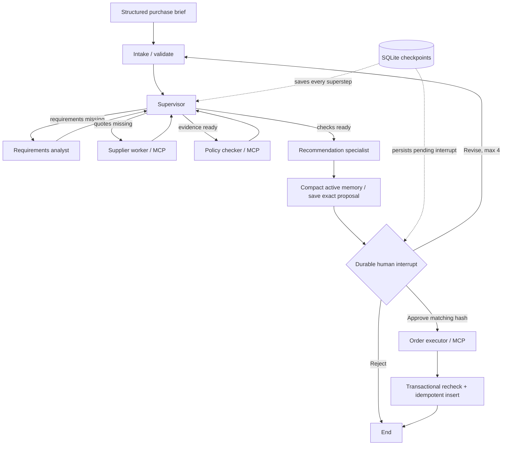

# ProcureFlow architecture

## Why this project

A purchasing request has a concrete outcome, several independent sources of evidence, and a legitimate approval boundary. The model specialists are the supervisor, requirements analyst, supplier research agent, and recommendation specialist. The supplier agent selects native MCP read calls; policy checking remains deterministic. The executor is a restricted write path, never a model-owned tool.

This is a local multi-account teaching application, not an ERP or payment processor. All six products and suppliers are fictional. Prices are integer INR inclusive of GST. No real bookings, emails, payments, or purchases occur.

## Components

- `api.py`: FastAPI endpoints and background jobs. Frontend polls saved graph state for progress. Jobs are in-process; the durable graph, rather than the job object, survives restart.
- `workflow.py`: typed `StateGraph`, conditional routes, explicit cycles, audit reducer and `interrupt()` / `Command(resume=...)`.
- `agents.py`: LangChain `ChatOllama` structured outputs with bounded worker inputs. Recommendation reason codes are verified against eligible quotes; prices, delivery and tradeoff text are rendered from trusted fields. Singleton routing is deterministic to avoid redundant model calls. Demo mode is an explicitly selected deterministic implementation. There is no silent fallback on model failure.
- `tools.py`: official MCP client; `initialize`, `list_tools`, then `call_tool` over stdio to a separate Python process. Up to three attempts for explicitly retryable tool results.
- `mcp_server.py`: official FastMCP server; exposes four tools with discovered JSON schemas.
- `store.py`: independent business SQLite connection per operation, WAL, transaction-bound stock/budget checks and idempotent writes.
- `memory.py`: typed semantic facts plus four recent exchanges. In model mode, the model merges older discussion into preferences, decisions and unresolved questions; demo mode uses deterministic structured records. Structured requirements remain authoritative. Full history remains in checkpoints.
- `auth.py`: scrypt password hashes, revocable persistent sessions, roles and rate limits. `accounts.py` provisions accounts through the trusted local operator interface.

## State schema

| Field | Purpose / update rule |
|---|---|
| `request_id`, `mode` | Stable workflow identity and explicit execution mode |
| `request` | Validated hard constraints; replaced only by a validated human revision |
| `assessment` | Requirements analysis |
| `quotes`, `policy` | Catalog evidence and deterministic per-quote checks |
| `recommendation`, `proposal`, `proposal_hash` | Explanation, exact action payload, SHA-256 fingerprint |
| `revision` | Maximum four revision cycles |
| `audit` | Append-only list reducer, `operator.add`; nodes return dictionary updates |
| `recent_turns`, `memory_summary`, `memory_facts` | Bounded recent context and typed semantic summary |
| `owner_id`, `reviewer` | Immutable requester identity and independent approval identity |
| `tool_trace` | Native selected tools, checked/canonical arguments and observed outcomes |
| `context_bytes`, `model_usage` | Measured bytes and reported model token usage, kept distinct |
| `order` | Confirmed local order receipt |
| `parent` | Source request and checkpoint for an alternative branch |

## MCP boundaries

| Tool | Access | Caller |
|---|---|---|
| `search_catalog` | Read; optional once-per-request/revision simulated failure | Supplier worker |
| `get_budget` | Read | Budget inspection / integration clients |
| `evaluate_quotes` | Read; reloads trusted catalog to avoid supplied-price spoofing | Policy checker |
| `create_purchase_order` | Write; independently requires stored approval | Executor after human interrupt |

The model sees task data, not direct access to the write tool or approval ledger. The application owns delegation/tool access. Discovery does not automatically grant every worker every tool.

## Approval and exactly-once business effect

1. Persist the complete proposal and hash with approval cleared.
2. Checkpoint a dynamic interrupt containing the exact proposal.
3. Validate the review payload and hash before resuming.
4. Persist approval for that request/hash after the interrupt returns.
5. Executor calls the MCP write tool. Inside `BEGIN IMMEDIATE`, check existing order, approval, current supplier terms, specs, budget and stock; insert one order and decrement stock atomically.
6. A unique `request_id` prevents duplicate orders. Replay with the same hash returns the original receipt; a different hash is rejected.

A model-generated "approved" string has no authority. A restart between commit and graph checkpoint can safely re-run the executor. An actual remote ERP would also need to honor an idempotency key; this local guarantee does not magically extend to external services.

## Checkpoints and time travel

SQLite checkpoints store intermediate supersteps and pending interrupts. Resume uses the same `thread_id`. The UI lists historical checkpoints. Branching first restores the selected snapshot's brief into the edit form. It preserves bounded working memory from that point and seeds a new thread with `aupdate_state`, resetting all derived outputs, orders and approvals, then recalculates with the edited brief. Source provenance and unaffected earlier requests remain visible.

This is a conservative checkpoint-based alternative branch, not an undo of external actions. A prior order stays committed. Each new branch requires independent approval and consumes its own stock/budget if eventually approved.

## Context and iteration budgets

- Four revisions maximum; graph recursion limit 80 per invocation.
- MCP tool attempts: three; real asynchronous 20-second read deadline per call.
- Native supplier loop: five iterations, at most two calls per iteration, only catalog/budget read tools. Unexpected read argument names are removed through explicit, audited normalization; traces retain both proposed and executed arguments. Request identity and fault settings are injected from validated state.
- Model request timeout: 90 seconds; output cap: 700 tokens; configured context: 8192.
- Worker input including schema/system/task is capped at 6500 UTF-8 bytes. This is a conservative guard for the tested model, not an exact tokenizer count. Ollama-reported usage is recorded separately.
- Recent conversation: four turns and a 6000-byte serialized working-memory ceiling. Typed summary is bounded to 2000 UTF-8 bytes. Hard constraints are stored separately and are never recovered from a potentially lossy summary.
- Full checkpoint history is intentionally retained for audit and time travel; active-context pruning is not database retention management.

## Operational limits

One Uvicorn worker with locally provisioned requester and approver accounts. Requesters can read and revise their own requests; an independent approver is required for order execution. Sessions and rate limits persist in SQLite. The native and container launchers expose HTTP on localhost only. The container process runs non-root and stores databases in a named volume. See SECURITY.md and DOCKER.md for exact boundaries.

Someone with arbitrary Python execution or database-file access is a trusted local operator; internal tests/evaluation SDK calls can create isolated fixtures without accounts. There is no public anonymous business API. There is no organization tenancy, MFA, password reset or encrypted database. Multiple app workers sharing a home are unsupported despite transactional order insertion. Sensitive production use requires further deployment work. Human reviews have no expiry; commit-time revalidation catches changed terms. No automatic purchase is allowed when no quote meets every constraint.
